  

hi, i'm carl. i study IT in bicol.

most of what i build starts because someone near me needed it. the POS app was for classmates who sell stuff at school and were tracking sales on paper. the library system is our capstone, so the whole campus is technically the client. the birthday and valentine sites were for people i care about, and honestly those are my favorite things on here.

right now i'm getting better at asp.net core and trying to write APIs that won't embarrass me six months from now. also making a roblox game. more on that when it stops breaking.

#### stuff you can open

- [POS](https://github.com/Caaaaaaaaaarl/POS): android point-of-sale, kotlin
- [PulseCare](https://github.com/Caaaaaaaaaarl/PulseCare): clinic appointments and reminders in asp.net core mvc, built with two classmates
- [InventoryManagementSystem](https://github.com/Caaaaaaaaaarl/InventoryManagementSystem): c# console app, my internet technologies midterm
- [Bolo_3A_Minimal_API](https://github.com/Caaaaaaaaaarl/Bolo_3A_Minimal_API): small REST API with asp.net minimal APIs

the library system, hoby and the TSA site are in private repos for now.

#### say hi

[facebook](https://www.facebook.com/heisekii/), or open an issue on any of my repos. i'll probably see it around 11:47 pm.
